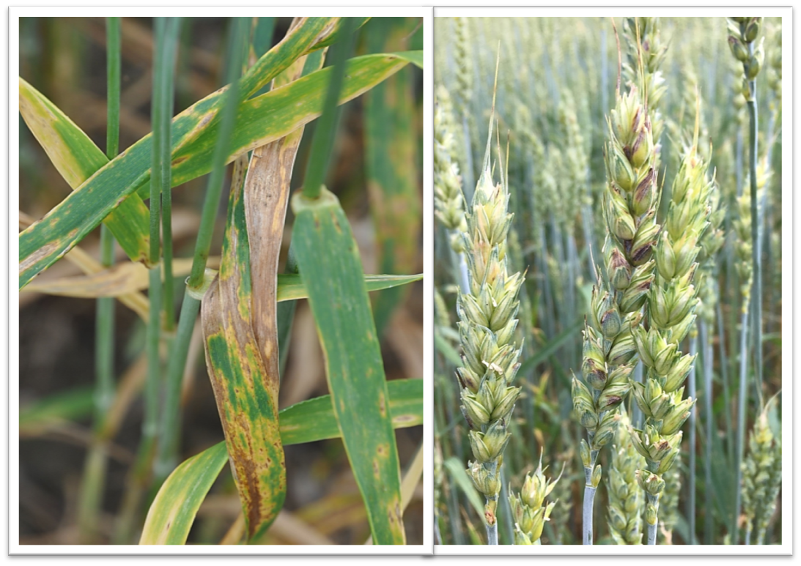
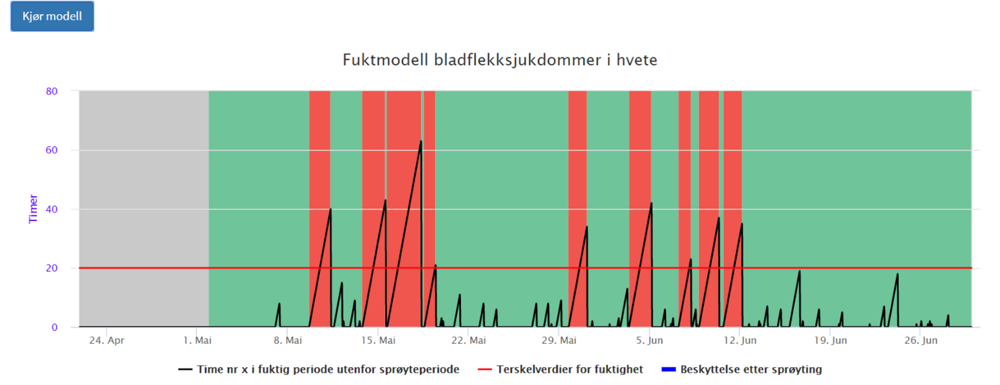
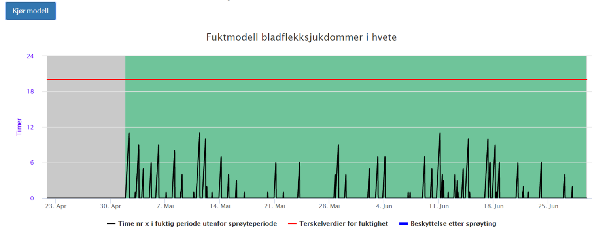

# SeptoriaHumidityModel

## English description from [the IPM Decisions Platform](https://platform.ipmdecisions.net/dss-info-list)

**THE PEST:** Leaf blotch diseases of wheat can be caused by septoria tritici blotch (*Zymoseptoria tritici*) and staganospora nodorum blotch (*Parastagonospora nodorum*), which are both  favoured by wet conditions. 
**THE DECISION:** Fungicide treatments may need to be applied between stem extension and ear emergence, mainly to protect the upper leaves.  
**THE MODEL:** Weather data from GS 31 are used. The humidity model estimates risk of septoria tritici blotch infections in winter wheat. Risk of attack is assumed after 20 hours with continuous wetness. A wet hour is defined as minimum 0,2 mm precipitation in an hour or minimum 85% relative humidity. 
**THE PARAMETERS:**  Dates of key growth stages are given as default values, but these may not be correct for your location.  To obtain accurate risk predictions it is essential to click on the 'Edit parameters' button, enter the estimated dates of GS31 (first node detectable), GS32 (second node; third upper leaf emerging), GS33 (third node; second upper leaf emerging), GS37/39 (uppermost flag leaf emerging)  and GS75 (grain content milky).  These estimated dates can be updated during the season as growth stages are reached. Adding information on septoria fungicide spray dates is vital for the model. After spraying, the model assumes that the crop is protected for 10 days.   
**SOURCE:** Created by Aahus University and SEGES and released in Denmark in 2017. Tested in Lithuania, Norway, Sweden, Finland and Denmark in 2018 and 2019. 
**ASSUMPTIONS:** septoria tritici blotch is present in the crop and periods with high humidity create risk for a damaging epidemic

### Crop
Winter Wheat, wheat

### Pest
Septoria leaf blotch, Glume blotch, Tan spot

### Author
Lise N. Jørgensen (Aarhus University)


## Norwegian description
<p>Skadegj&oslash;rer(e): hveteaksprikk, hvetebladprikk og hvetebrunflekk + (<em>Parastagonospora nodorum, Zymoseptoria tritici, Pyrenophora tritici-repentis</em>)</p>
<p><br /><em>Typiske symptomer av bladflekksjukdommer i hvete og hveteaksprikk i felt.</em></p>
<h3>Modellbeskrivelse</h3>
<p>Fuktmodellen er et beslutningsst&oslash;tteverkt&oslash;y, utviklet av <a href="https://www.seges.dk/">SEGES</a>, DK for &aring; kunne vurdere risiko for angrep av hvetebladprikk i h&oslash;sthvete under danske forhold. Modellen er basert p&aring; antall timer med bladfuktighet. Bladfuktighet er definert som nedb&oslash;r (0,2 mm) eller 85 % luftfuktighet i minst 30 min/time m&aring;lt fra den n&aelig;rmeste v&aelig;rstasjonen.</p>
<p>F&oslash;r modellen kan kj&oslash;res, er det viktig &aring; legge inn n&aelig;rmeste m&aring;lestasjon for &aring; kunne innhente v&aelig;rdata fra de siste 3 dagene og prognosen for de neste 3 dagene fremover. I tillegg legges det inn dato for n&aring;r utviklingsstadium BBCH 31 eller 32 inntreffer. Modellen beregner forventet dato for de andre utviklingsstadiene, som kan justeres manuelt ved avvik.</p>
<p>Det er ogs&aring; viktig &aring; legge inn data for evt. gjennomf&oslash;rte spr&oslash;ytinger. Etter spr&oslash;yting med fungicider som er effektive mot bladflekksjukdommer (*) g&aring;r modellen ut fra at plantene er beskyttet i en periode p&aring; 10 dager.</p>
<p>Antall timer med bladfuktighet som utl&oslash;ser et varsel og prosent luftfuktighet som definerer en fuktig time kan justeres manuelt pga. aktuelle informasjon fra det aktuelle feltet for eksempel sortsresistens, sjukdomspress i &aring;keren, forgr&oslash;de (kryss av &laquo;Vis avanserte innstillinger&raquo;).</p>
<p>(*) Aviator Xpro, Siltra Xpro, Delaro, Elatus Era, Proline eller blandinger med disse midlene (se ogs&aring; <a href="https://www.plantevernguiden.no/" target="_blank" rel="noopener">Plantevernguiden</a>)</p>
<p>&nbsp;</p>
<h3>Tolking av varsel</h3>
<p>N&aring;r antall timer med bladfuktighet i en mottakelig sort n&aelig;rmer seg 20, vil risikokurven g&aring;r over i et r&oslash;dt omr&aring;de og direkte bekjempingstiltak skal vurderes pga. av &oslash;kt infeksjonsrisiko. Det vises ogs&aring; en prognose for de kommende dager.</p>
<p>&nbsp;</p>
<p><br /><em>Fig. 1a Eksempel p&aring; h&oslash;yt antall varsler (i r&oslash;dt) for &Aring;s, v&aring;rhvete i 2017, gjennom hele sesongen uten spr&oslash;yting.</em></p>
<p><br /><em>Fig. 1b Eksempel p&aring; lav risiko, ingen varsel for &Aring;s, v&aring;rhvete i 2018, gjennom hele sesongen uten spr&oslash;yting.</em></p>
<h3>Varslingssesong &ndash; oppstart og avslutning av varsel</h3>
<p>Modellen begynner &aring; oppsummere antall fuktige timer ved utviklingsstadium BBCH 32.</p>
<h3>Utpr&oslash;ving og validering av modellen</h3>
<h4>Nasjonalt</h4>
<p>Vi har gjennomf&oslash;rt 8 feltfors&oslash;k hos NLR i 2018 og 2019 med spr&oslash;yting etter fuktmodellen i (Ficke et al. 2020)</p>
<p>&nbsp;</p>
<h4>Internasjonalt</h4>
<p>Fuktmodellen ble testet ved Aarhus Universitet, Danmark fra 2014 til 2015 og 2017 til 2018. I tillegg har vi testet modellen i DK, SE, LT, og FI i 2018 og 2019 (Nistrup J&oslash;rgensen <em>et al</em>. 2020, i arbeid).</p>
<h3>Referanser</h3>
<p>Ficke, A., Grieu, C. &amp; Nordskog, B. 2020. Testing av ulike modeller for bladflekksjukdommer i hvete og bygg. Jord- og plantekultur 2020. NIBIO BOK 6 (1): 86-91.</p>
<p>Kontaktperson: Andrea Ficke (andrea.ficke@nibio.no)</p>
<h3>Lenker til mer informasjon</h3>
<p><u><a href="https://www.plantevernleksikonet.no/l/oppslag/617/">Om hveteaksprikk i plantevernleksikonet</a></u></p>
<p><u><a href="https://www.plantevernleksikonet.no/l/oppslag/319/">Om byggbrunflekk i plantevernleksikonet</a></u></p>
<p><a href="https://www.plantevernleksikonet.no/l/oppslag/618/">Om hvetebladprikk i plantevernleksikonet</a></p>


## Development

Clone Gitlab repository

```
$ git clone https://gitlab.nibio.no/VIPS/models/java/Model_SEPTORIAHU.git
$ cd Model_SEPTORIAHU
```

### Compile, run tests
```bash
mvn clean install
```

### Deploy to VIPSCore
See [the VIPSCore README](https://gitlab.nibio.no/VIPS/VIPSCore)